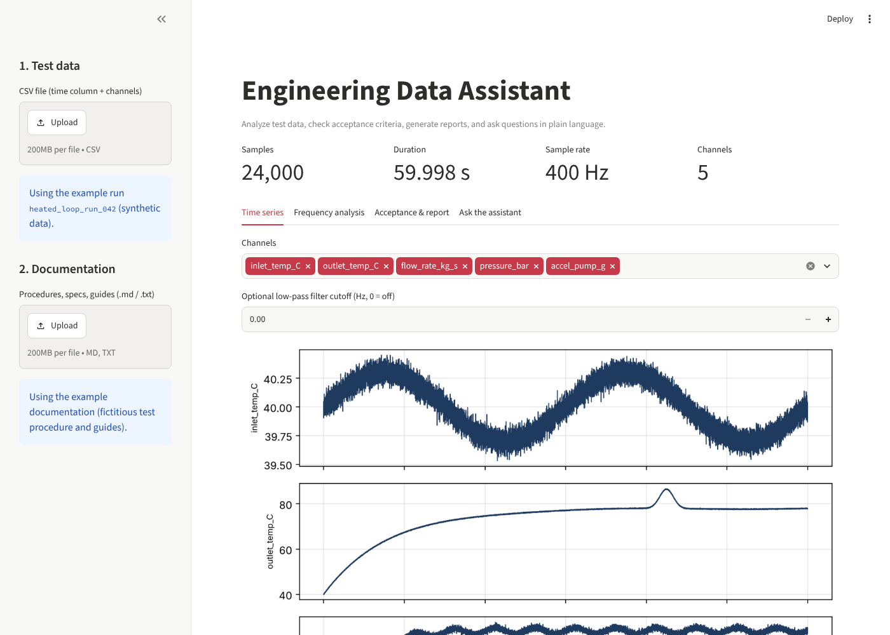
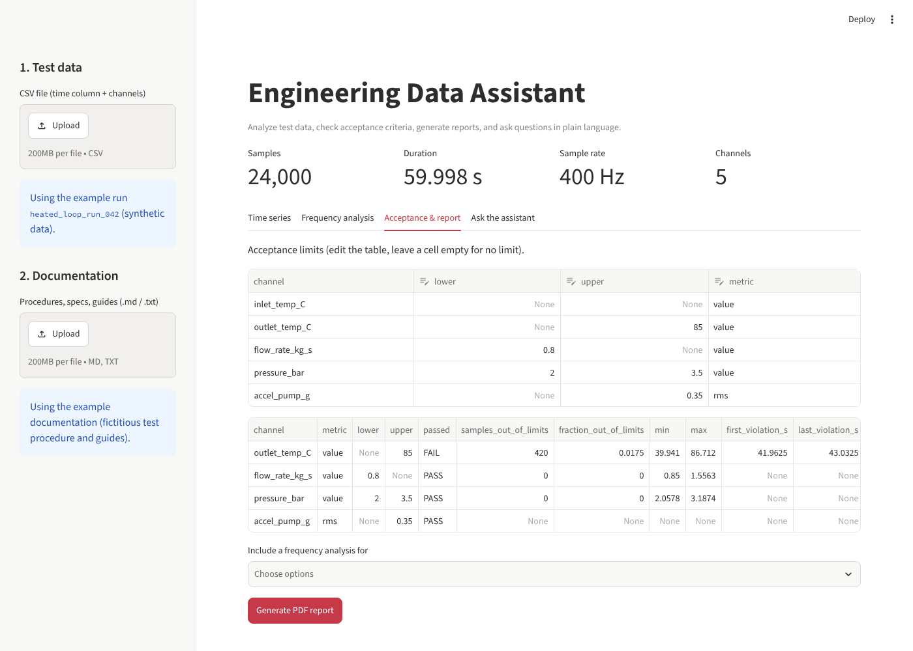

# Engineering Data Assistant

A small tool for test engineers: load a test run, check it against acceptance criteria,
generate a PDF test report in one click, and ask questions about the data and the test
procedure in plain language.

It was built as a prototype of the kind of digital tool that removes repetitive work from
engineering teams: the manual "open the CSV, plot it, compare with the procedure, write the
report" loop that follows every test.



## What it does

| Need of the engineer | Feature |
|---|---|
| Look at a test run quickly | Interactive time-series view, optional low-pass filter, statistics per channel |
| Identify a vibration source | Power spectral density (Welch) and dominant-frequency detection |
| Check acceptance criteria | Editable limits per channel (instantaneous or RMS), PASS/FAIL with time of first violation |
| Write the test report | Automatic PDF report: overview, statistics, acceptance checks, figures |
| Find the right requirement | Local search over procedures, specifications and guides |
| Ask "does this run pass, and why?" | Claude-based assistant that calls the analysis tools and cites the documentation |



## Example

The repository ships with a **synthetic** run of a heated water loop (temperatures, pressure,
flow rate, pump vibration) and three **fictitious** documents: a test procedure, an
instrumentation guide and a troubleshooting guide. A short outlet-temperature overshoot is
included on purpose.

For a question such as *"Does this run meet the acceptance criteria of the test procedure? If
not, what does the troubleshooting guide suggest?"*, the assistant has the tools to:

1. search the documentation for the acceptance criteria (`TP-HL-001`);
2. call `threshold_check` on each channel with those limits;
3. find that the outlet temperature exceeds 85 °C between about 42 s and 43 s
   (the deterministic check below gives the same result without the assistant);
4. search the troubleshooting guide for the likely cause;
5. answer with the numbers, the PASS/FAIL status of each criterion and the cited passages.

Every tool call is shown under the answer, so the engineer can check how it was built.

## Design choices

- **Raw data stays local.** All analysis runs in Python on the engineer's machine. The model
  only receives the small JSON results of the tools it calls (statistics, check results,
  document passages), never the full dataset.
- **No invented numbers.** The system prompt requires every value and limit to come from a
  tool call or a cited document passage, and unchecked items to be reported as such.
- **Auditable.** Each answer comes with the list of tool calls and their outputs.
- **Robust tool calls.** Tool schemas use `strict: true`, so arguments always match the schema;
  tool errors are returned to the model (`is_error`) instead of crashing the app.
- **Works offline for everything except the assistant.** Plots, checks and reports do not
  need an API key.

## Architecture

```
app.py                       Streamlit interface
src/eda_assistant/
  data.py                    loading, statistics, filtering, spectrum, threshold checks
  plots.py                   matplotlib figures
  report.py                  PDF report generation (ReportLab)
  docs.py                    TF-IDF search over Markdown / text documentation
  assistant.py               Claude tool-use loop over the local analysis tools
  cli.py                     command line (report generation, questions)
examples/                    synthetic data, fictitious documents, acceptance limits
tests/                       pytest suite (the agent loop is tested with a fake client)
```

The assistant uses the Anthropic Messages API with a tool-use loop (`claude-opus-5-5`,
adaptive thinking, server-side fallback on refusals).

## Getting started

```bash
git clone https://github.com/sarahggs1/engineering-data-assistant.git
cd engineering-data-assistant
python -m venv .venv && source .venv/bin/activate
pip install -e ".[dev]"
streamlit run app.py
```

To use the assistant, set an Anthropic API key (or log in with `ant auth login`):

```bash
export ANTHROPIC_API_KEY=...
```

Command line:

```bash
eda report examples/data/heated_loop_run_042.csv --limits examples/limits.json --spectrum accel_pump_g -o report.pdf
eda ask examples/data/heated_loop_run_042.csv --docs examples/docs "Does this run meet the acceptance criteria?"
```

Tests:

```bash
pytest
```

## Possible next steps

- Read other formats used on test benches (TDMS, HDF5, MATLAB files).
- Compare several runs and track a quantity across a test campaign.
- Embedding-based search and PDF ingestion for larger documentation sets.
- Run the model on an internal deployment for sensitive data.

## About

Built by Sarah Gbala Sapoulou with [Claude Code](https://claude.com/claude-code).
All data and documents in this repository are synthetic or fictitious.
